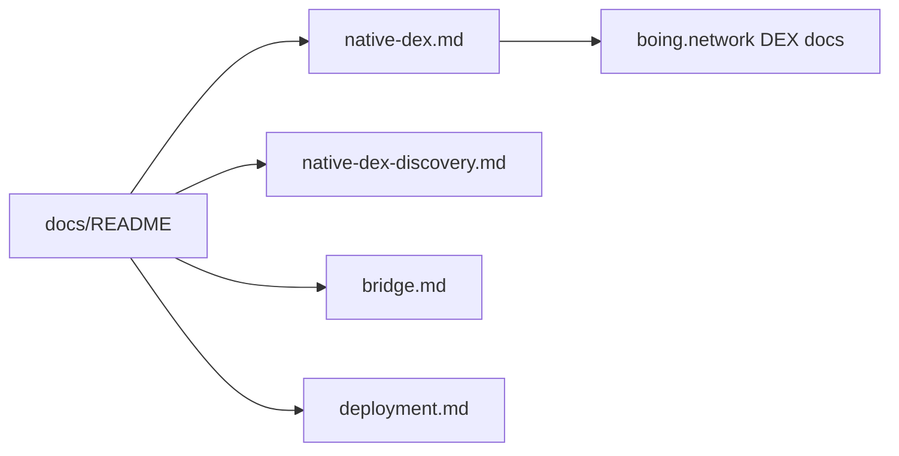

# 📚 boing.finance — documentation index

> 👋 **Everyday users:** the app is [boing.finance](https://boing.finance), a DEX on Boing Network. Trade with [Boing Express](https://boing.express). The Bridge page also connects EVM and Solana wallets for LI.FI transfers between other chains.  
> 🛠️ **Developers:** this folder is the engineering map. Canonical env: `frontend/.env.example`.  
> 🛰️ **Operators:** `cd frontend && npm run smoke:boing-rpc` against public testnet.

| Doc | Description |
|-----|-------------|
| [native-dex.md](./native-dex.md) | How the app uses the Boing VM AMM, roadmap, Uniswap-parity matrix, indexer |
| [native-dex-discovery.md](./native-dex-discovery.md) | `boing_listDexTokens` / `boing_listDexPools` spec, client wiring, operator definition of done |
| [bridge.md](./bridge.md) | LI.FI bridge for other chains (live), 0.5% fee, and the planned native Boing ↔ Base bridge |
| [deployment.md](./deployment.md) | Cloudflare Workers/Pages, D1 migrations |
| [configuration.md](./configuration.md) | Production env + optional API keys |
| [boing-tokenomics.md](./boing-tokenomics.md) | Pointer to where BOING (Boing Network L1 token) economics are documented |
| [../frontend/docs/DESIGN.md](../frontend/docs/DESIGN.md) | App visual system |
| [../scripts/README.md](../scripts/README.md) | Optional Python asset scripts |

**Upstream (Boing Network):** [HANDOFF-DEPENDENT-PROJECTS.md](https://github.com/Boing-Network/boing.network/blob/main/docs/HANDOFF-DEPENDENT-PROJECTS.md) — Express, Observer, partner dApp backlog.

**Ops:** from `frontend/`, `npm run smoke:boing-rpc` verifies public Boing testnet JSON-RPC (`boing_chainHeight`; optional `boing_qaCheck` via `BOING_SMOKE_BYTECODE_HEX`).
