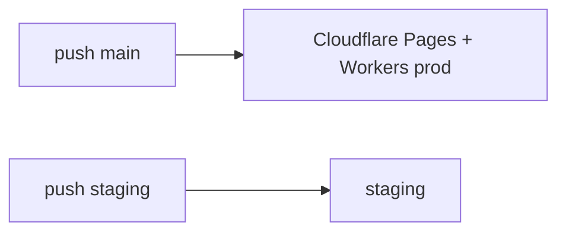

# Deployment & Production Configuration

> 👋 **Everyday users:** production is [boing.finance](https://boing.finance). You do not deploy it.  
> 🛠️ **Developers:** push `main` → production (backend + frontend). `staging` only deploys the frontend preview. Secrets: `CLOUDFLARE_API_TOKEN`, `CLOUDFLARE_ACCOUNT_ID`.  
> 🛰️ **Operators:** frontend output directory is **`dist`**, not `build`.

Complete guide for deploying boing.finance to Cloudflare Workers and Pages, and production checklist.



---

## Quick Start

### Automated Deployment (Recommended)

- **Push to `main`** → Deploys to **production**
- **Push to `staging`** → Deploys the **staging frontend** only (backend has no staging Worker)

**Requirements:** GitHub Secrets configured (see Setup). Projects auto-created on first deployment.

### Manual Deployment

```bash
./deploy-backend.sh production
./deploy-frontend.sh staging  # or production
```

---

## Setup

### 1. GitHub Secrets

GitHub → Settings → Secrets and variables → Actions:

- **`CLOUDFLARE_API_TOKEN`** – [Cloudflare Dashboard](https://dash.cloudflare.com/profile/api-tokens) (Workers:Edit, Pages:Edit)
- **`CLOUDFLARE_ACCOUNT_ID`** – Cloudflare Dashboard sidebar

### 2. Cloudflare Resources

**Pages (auto-created):** `boing-finance-prod`, `boing-finance` (staging)  
**Workers:** `boing-api-prod` (the only deployed backend; the former `boing-api` and `boing-api-staging` Workers were deleted)  
**R2:** `boing-storage`, `boing-storage-preview`

### 3. URLs

| Environment | Frontend | Backend |
|-------------|----------|---------|
| Production | https://boing.finance | https://boing-api-prod.nico-chikuji.workers.dev |
| Staging (frontend only) | https://boing-finance.pages.dev | https://boing-api-prod.nico-chikuji.workers.dev (shared; there is no staging API Worker) |

---

## Production Configuration

### Custom Domains (Completed)

- `boing.finance` and `www.boing.finance` → `boing-finance-prod`

### Environment Variables (Cloudflare Pages Dashboard)

**Required:**
```
REACT_APP_ENV=production
REACT_APP_BACKEND_URL=https://boing-api-prod.nico-chikuji.workers.dev
```

(`REACT_APP_ENVIRONMENT` is an alias; see [configuration.md](./configuration.md).)

**Optional:** Set in Pages → `boing-finance-prod` → Settings → Environment Variables. Canonical list: `frontend/.env.example`.

### Security & Build

- `_headers` and `_redirects` in `frontend/public/` (security headers, www→apex redirect)
- Build output: **`dist`** (Vite); production branch: `main`
- SSL/TLS and DNS via Cloudflare

### Verification

```bash
curl -I https://boing.finance
# Test SPA: https://boing.finance/swap
```

---

## Backend

### D1 Migrations

```bash
cd backend
wrangler d1 execute boing-database --remote --file=./d1-portfolio-snapshots.sql
```

Numbered migrations live in `backend/migrations/` and are applied by hand, in order:

```bash
wrangler d1 execute boing-database --remote --file=./migrations/0001_core_tables.sql
wrangler d1 execute boing-database --remote --file=./migrations/0002_drop_solana_deployments.sql
```

Back up any table before a migration drops it (`wrangler d1 execute boing-database --remote --json --command "SELECT * FROM <table>"`).

### KV Caching

```bash
npx wrangler kv namespace create BOING_CACHE
npx wrangler kv namespace create BOING_CACHE --preview
```
Add returned IDs to `wrangler.toml` under `[[kv_namespaces]]`.

---

## Troubleshooting

- **Deployment fails:** Check GitHub Actions logs; verify token permissions.
- **Site doesn’t load:** Wait 1–2 min; check Cloudflare Dashboard and Actions status.

**Related:** `.github/workflows/`, `deploy-backend.sh`, `deploy-frontend.sh`
